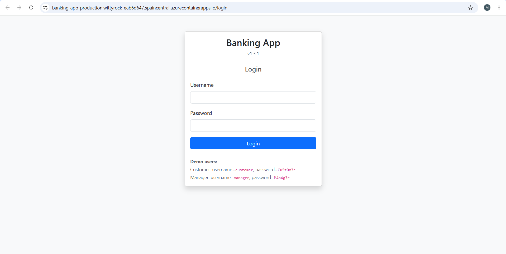
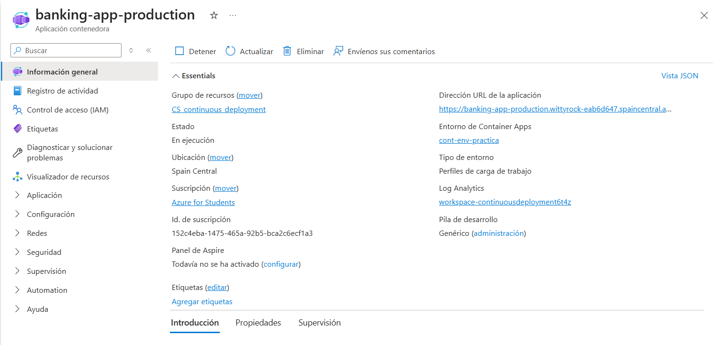
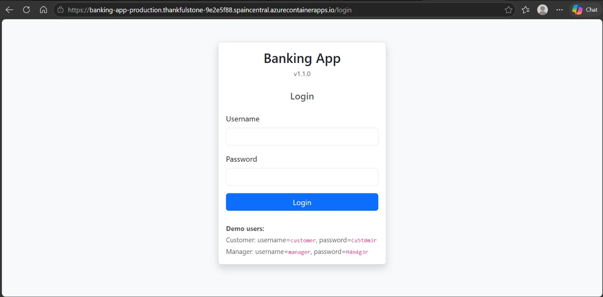
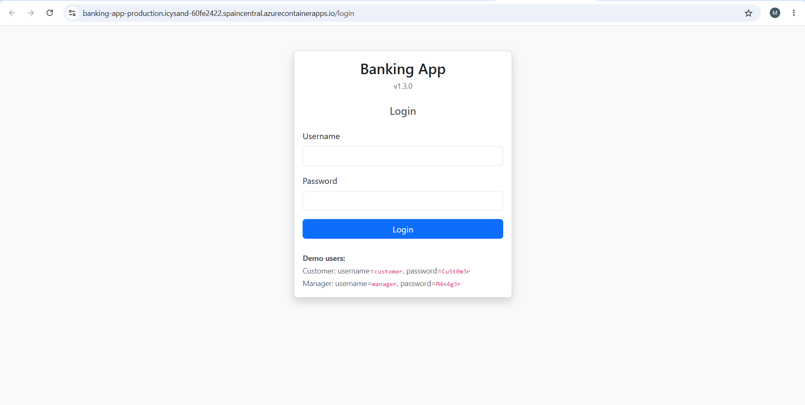
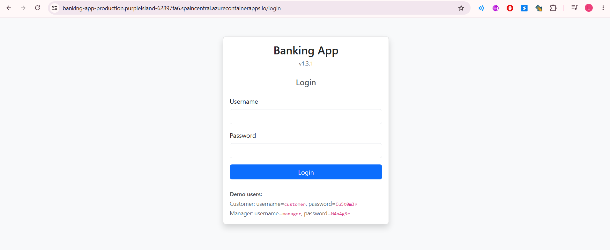

# Praćtica 1 - Control de calidad de una aplicación web 

**Grupo 2**

## Miembros del Equipo
| Nombre y Apellidos | Correo URJC | Usuario GitHub |
|:--- |:--- |:--- |
| Marcos García García | m.garciaga.2022@alumnos.urjc.es | marcosgrc |
| Adrián Muñoz Serrano | a.munozse.2022@alumnos.urjc.es | adri04ms |
| Jorge Padilla Rodríguez | j.padilla.2021@alumnos.urjc.es | Jorge-PR |
| Naroa Martín Simón | n.martins.2022@alumnos.urjc.es | NaroaMS04 |
| Alberto Mayoral Gómez | a.mayoral.2022@alumnos.urjc.es | Albermg27 |
| Icíar Moreno López | i.morenolo.2022@alumnos.urjc.es | IciarML |
| Laura Pineda Ballesteros | l.pineda.2022@alumnos.urjc.es | lauraxpb |

---

### **Participación de Miembros en la Práctica 1**

#### **Alumno 1 - Marcos García García**

Para esta práctica he realizado las siguientes tareas: organizar la plantilla inicial del documento ANALISIS_CALIDAD.md, añadir el code smell 1 (Literales duplicados) detectado por SonarCloud y añadir dos code smells detectados manualmente, el 1 (Duplicación de código en métodos deposit) y el 4 (Método demasiado largo).

| Nº    | Commits      |
|:------------: |:------------:|
|1| [Plantilla de la memoria .md](https://github.com/Albermg27/cs-2026-grupo-2/commit/77c3c9600e47dc3e24a7eba3e93b1fbdb354e9d3)  |
|2| [Bad Smell: Duplicación de código en métodos deposit](https://github.com/Albermg27/cs-2026-grupo-2/commit/0735e27565d2932f82a75d56360c51f2d46cfdf6)  |
|3| [Bad Smells: Literales duplicados y Método demasiado largo](https://github.com/Albermg27/cs-2026-grupo-2/commit/ea6557df578fb3ab0acf6d9aa2bb0c1ff5ac259b)  |


---

#### **Alumno 2 - Adrián Muñoz Serrano**

Para esta práctica he realizado las siguientes tareas: he identificado manualmente dos code smells en el proyecto; Data Clumps y Magic Numbers, ambos localizados en la clase AccountService.java. Además, he añadido el code smell 2 (Variable local no utilizada) y el code smell 3 (Comparación de Strings con operador de identidad) detectados por SonarCloud.

| Nº    | Commits      |
|:------------: |:------------:|
|1| [Bad Smells: Data Clumps y Magic Numbers](https://github.com/Albermg27/cs-2026-grupo-2/commit/2008713329e8d1ad508ef72a494dd66ae1d104eb)  |
|2| [Bad Smells SonarCloud: Variable local no utilizada y Comparación de Strings con operador de identidad](https://github.com/Albermg27/cs-2026-grupo-2/commit/29af02cd1448e647b9d99a9d1e8028cc15ce60b2)  |

---

#### **Alumno 3 - Jorge Padilla Rodríguez**

Durante esta práctica he realizado la detección manual de los siguientes code smells: bad smell 11, referente a la existencia de código muerto dentro del método deposit; bad smell 12, que describe código duplicado o redundante dentro del método deposit; bad smell 13, que muestra cómo aparece código duplicado (la validación de una variable) a lo largo de los métodos deposit, withdraw y transfer; bad smell 14, donde vemos que el método rm tiene un nombre poco comunicativo.

| Nº    | Commits      |
|:------------: |:------------:|
|1| [Bad smell 11: código muerto dentro del método deposit](https://github.com/Albermg27/cs-2026-grupo-2/commit/bb9f0a1d3d3ad7f0617ce1bad77b251c15ba8c37)  |
|2| [Bad smells 12 y 13: código duplicado en deposit y en varios métodos](https://github.com/Albermg27/cs-2026-grupo-2/commit/e8e92c37d5d9b2904fbcb7993ad92e329bebb905)  |
|3| [Bad smell 14: nombre de método poco comunicativo](https://github.com/Albermg27/cs-2026-grupo-2/commit/7807b3b361d84d4ff161600c8df9f82b68016a0f)  |

---

#### **Alumno 4 - Naroa Martín Simón**

En esta práctica me he encargado de revisar a mano la clase AccountService.java para encontrar fallos de diseño que SonarCloud no detecta. He analizado dos problemas: Primitive Obsession, que trata sobre cómo el uso excesivo de tipos básicos (como double o String) para el dinero o las cuentas puede causar errores; y Feature Envy, donde he explicado que el servicio está "cotilleando" demasiado el saldo de las cuentas en lugar de dejar que la propia clase Account gestione su lógica interna.

| Nº    | Commits      |
|:------------: |:------------:|
|1| [Bad smells 8 and 9 added: Primitive Obsession y Feature Envy](https://github.com/Albermg27/cs-2026-grupo-2/commit/caa1cef5baf1f8c89de75bc97b75bcaefff4818a)  |

---

#### **Alumno 5 - Alberto Mayoral Gómez**

En esta práctica he realizado una revisión manual del código para identificar problemas de calidad. Como resultado, detecté dos code smells: Mysterious Names / Non-Descriptive Names, relacionado con el uso de nombres poco descriptivos que dificultan la comprensión del código, y Large Class, que indica que una clase tiene demasiadas responsabilidades, afectando a la mantenibilidad y organización del sistema.

| Nº    | Commits      |
|:------------: |:------------:|
|1| [Bad Smell 2: Mysterious Names / Non-Descriptive Names](https://github.com/Albermg27/cs-2026-grupo-2/commit/2738af3575546148ee3ccedcae3b236e8c44a39c)  |
|2| [Bad Smell 3: Large Class](https://github.com/Albermg27/cs-2026-grupo-2/commit/0be9ed6c9634d7111eb1c08acc194acd8dd18ee9)  |

---

#### **Alumno 6 - Icíar Moreno López**

En esta práctica me he encargado de combinar el análisis automático de SonarCloud con una inspección manual de la clase AccountService.java. Mi enfoque se ha centrado en detectar problemas de acoplamiento y falta de polimorfismo que degradan la mantenibilidad del sistema. He analizado en profundidad dos problemas críticos: el uso de Switch Statements en el sistema de avisos, que obligaría a modificar el servicio cada vez que se añada un canal de comunicación, y la Intimidad Inapropiada en la comparación de cuentas, donde el servicio manipula datos internos de las entidades rompiendo el encapsulamiento.

| Nº    | Commits      |
|:------------: |:------------:|
|1| [Bad Smell - Switch Statement](https://github.com/Albermg27/cs-2026-grupo-2/commit/9f86495ce5937a22a79f828cc51459325cf4d39f)  |
|2| [Bad Smell - Inappropriate Intimacy](https://github.com/Albermg27/cs-2026-grupo-2/commit/beb050539ddb2f481fd6e17c7466f96c7d41ae23)  |

---

#### **Alumno 7 - Laura Pineda Ballesteros**

En esta práctica he añadido dos nuevos bad smells en la memoria de análisis: **Generic Exception Catching** (captura genérica de excepciones en controladores) y **Temporary Stub / Incomplete Business Logic** (algoritmo de aprobación de préstamos con retorno fijo de aprobado).

| Nº    | Commits      |
|:------------: |:------------:|
|1| [Bad smells 15 y 16 añadidos en ANALISIS_CALIDAD.md](PENDIENTE_ENLACE_COMMIT)  |

---

### **Participación de Miembros en la Práctica 3**

#### **Alumno 1 - Marcos García García**

Para esta práctica he realizado las siguientes tareas: crear la estructura inicial de AccountServiceTest, los tests del método deposit y los tests para el método createAccount. También he refactorizado los bad smells: literales duplicados, código duplicado (deposit) y método grande (transfer), y añadí la explicación de la refactorización en el fichero ANALISIS_CALIDAD. Finalmente, he creado el test E2E que prueba la transferencia entre cuentas propias, además de crear la estructura inicial de la clase TransferE2ETest.

| Nº    | Commits      |
|:------------: |:------------:|
|1| [Estructura inicial de AccountServiceTest y tests del método deposit](https://github.com/Albermg27/cs-2026-grupo-2/commit/74b2d08d7345186a7dd7153e3d390a2740fb2df4)  |
|2| [Tests para el método createAccount y tests restantes de deposit](https://github.com/Albermg27/cs-2026-grupo-2/commit/b428e721387b0c0f9240f250ff82b59e4cbefd3e)  |
|3| [Refactorizar bad smells: literales duplicados, código duplicado (deposit) y método grande (transfer)](https://github.com/Albermg27/cs-2026-grupo-2/commit/d1a2f1e637796a3de2a0cecb03de51e421af9c94)  |
|4| [Test E2E: Transferencia entre cuentas propias y estructura inicial TransferE2ETest](https://github.com/Albermg27/cs-2026-grupo-2/commit/9d28324185aa76ad39c33fb152a333c150da58c0)  |

#### **Alumno 2 - Adrián Muñoz Serrano**

Para esta práctica he realizado las siguientes tareas: implementación de los tests unitarios `getAccount` y `getUserAccounts` en `AccountServiceTest`. He refactorizado los bad smells en `AccountService`: eliminación de la variable no utilizada `seccondAccount`, corrección de la comparación de Strings con `.equals()`, y extracción de límites numéricos (Magic Numbers) a constantes. Además, he validado la refactorización de `sendNotification` (Data Clump) y he creado el test E2E de transferencia entre cuentas de distintos usuarios.

| Nº    | Commits      |
|:------------: |:------------:|
|1| [Tests unitarios para los métodos getAccount y getUserAccounts](https://github.com/Albermg27/cs-2026-grupo-2/commit/210a055dbff54e41c5d71d875f0954e5686ff5b9) |
|2| [Refactorización de bad smells: variable no usada, comparación de Strings y Magic Numbers](https://github.com/Albermg27/cs-2026-grupo-2/commit/0dcda605afd0440f266b9c31b754dd134168125c) |
|3| [Test E2E: Transferencia entre cuentas de distintos usuarios](https://github.com/Albermg27/cs-2026-grupo-2/commit/87e3a628f953a2541a9154c4b692ba9fd3a73633) |

#### **Alumno 3 - Jorge Padilla Rodríguez**

En esta práctica he implementado los tests unitarios necesarios para cubrir la totalidad del código del método `transfer`, entre los que se encuentran los tests parametrizados `transfer_invalidAmounts_throwsException`, `transfer_accountNotFound_throwsException`, y `transfer_validParametersAndSuccess_allNotificationScenarios`, así como el resto de tests relacionados con este método. De la misma manera, he realizado las refactorizaciones necesarias para los Bad Smells 11, 12, 13 y 14, así como la explicación de estos en el fichero ANALISIS_CALIDAD.md. Posteriormente, he implementado la prueba automática de sistema que verifica que no se puede realizar una transferencia si la cantidad supera los 20.000€. Mencionar también la incorporación en el pom.xml del plugin de JACOCO necesario para comprobar la cobertura del código.

| Nº    | Commits      |
|:------------: |:------------:|
|1| [Plugin de JACOCO](https://github.com/Albermg27/cs-2026-grupo-2/commit/7fd945d291e8f504d8ce9b5ecc73d2906455ed54) |
|2| [Tests unitarios para el método transfer](https://github.com/Albermg27/cs-2026-grupo-2/commit/8ee22373a6f20f4733713c7ecd1cb643e63f9d79) |
|3| [Refactorización de Bad Smells 13 y 14](https://github.com/Albermg27/cs-2026-grupo-2/commit/edb18031bc2a418fb16a866ad5d4248a2666796c) |
|4| [Refactorización de Bad Smell 12](https://github.com/Albermg27/cs-2026-grupo-2/commit/f41eedf5702d6d49e13ca2fe43dd72936d378e31) |
|5| [Test E2E: "No se puede realizar una transferencia si la cantidad supera los 20.000€"](https://github.com/Albermg27/cs-2026-grupo-2/commit/a54a0040011033f7ccea08e026573c625d63c655)  |

#### **Alumno 4 - Naroa Martin Simón**

He implementado pruebas unitarias para los métodos de consulta de saldo y transacciones (getBalance y getTransactions), asegurando que la recuperación de datos sea precisa. 
En cuanto a la refactorización, he corregido los "bad smells" de Primitive Obsession y Feature Envy mediante el uso de Value Objects, mejorando la encapsulación y la robustez del modelo de dominio. Además, he ajustado las aserciones de los tests para adaptarlas a los nuevos parámetros definidos. 
Por último, he desarrollado una prueba de sistema (E2E) con Selenium que garantiza que el sistema bloquea correctamente cualquier intento de transferencia cuando la cuenta de origen y destino son la misma, protegiendo la integridad de la base de datos.

| Nº | Commits      |
|:--:|:------------:|
| 1  | [Added unit tests for getBalance and getTransactions](https://github.com/Albermg27/cs-2026-grupo-2/commit/fa63e2914fed30db358fe565c2142088b0383cfb)  |
| 2  | [Refactor: fix primitive obsession and feature envy bad smells by using Value Objects](https://github.com/Albermg27/cs-2026-grupo-2/commit/32993d95848b95ab91118f321d101334f33b00c4)  |
| 3  | [Test assertion to new parameters fix](https://github.com/Albermg27/cs-2026-grupo-2/commit/5d988c657412bc1dcba7db9520a2e7e0b6ede6d3)  |
| 4  | [Added E2E test for same account transfer restriction](https://github.com/Albermg27/cs-2026-grupo-2/commit/d3dc4c539b598e6c4e08e323c5ecb892c13f6e3f)  |

#### **Alumno 5 - Alberto Mayoral Gómez**

Para esta práctica he añadido nuevas pruebas unitarias y test E2E, además de participar en la refactorización de varios bad smells y en la documentación del análisis de calidad. En concreto, he desarrollado los tests unitarios del método rm(String accountNumber), he realizado la refactorización del bad smell Mysterious Names / Non-Descriptive Names, he actualizado la documentación del bad smell Large Class en el fichero ANALISIS_CALIDAD.md y he implementado una prueba E2E que verifica que no se puede realizar una transferencia si la cantidad es negativa.

| Nº | Commits      |
|:--:|:------------:|
| 1  | [Tests Unitario: rm(String accountNumber)](https://github.com/Albermg27/cs-2026-grupo-2/commit/fbf5a89bac0db953140e6883828a344cb32dbf82)  |
| 2  | [Bad smell: Mysterious Names / Non-Descriptive Names refactor](https://github.com/Albermg27/cs-2026-grupo-2/commit/ada60f3d966fe5e032dbe4ce4be5bb0879ee8a22)  |
| 3  | [Bad smell: Large Class](https://github.com/Albermg27/cs-2026-grupo-2/commit/e6e3bc92378068f875fce8954590d9c9c0651d3b)  |
| 4  | [E2E test: "No se puede realizar una transferencia si la cantidad es negativa"](https://github.com/Albermg27/cs-2026-grupo-2/commit/d8b38f04ff1011339957040379e4071f87d476b6)  |


#### **Alumno 6 - Icíar Moreno López**

He realizado las pruebas unitarias para asegurar que el proceso de sacar dinero funciona correctamente en todos los casos (método withdraw). He simplificado el sistema de notificaciones para que no haya código repetido y sea más fácil de mantener (Bad Smell Switch Statement). También he corregido la forma en la que las cuentas se comparan entre sí para mejorar la organización del código (Bad Smell Inappropriate Intimacy). Por último, he programado una prueba de sistema que verifica que el sistema bloquea las transferencias si el cliente no tiene dinero suficiente.

| Nº | Commits      |
|:--:|:------------:|
| 1  | [Pruebas unitarias del método withdraw](https://github.com/Albermg27/cs-2026-grupo-2/commit/fef564df18b1e0dcc9bb176c555fd781a3cc5355)  |
| 2  | [Refactorización: Switch Statement](https://github.com/Albermg27/cs-2026-grupo-2/commit/bbeaf665b9a5c019e3a790fc5a3d43784a9374dd)  |
| 3  | [Refactorización: Inappropriate Intimacy](https://github.com/Albermg27/cs-2026-grupo-2/commit/0409e6d3e8f86ddae5d1a11f8d3ce2faefde9e16)  |
| 4  | [Prueba de sistema: No se puede realizar una transferencia si no hay saldo suficiente](https://github.com/Albermg27/cs-2026-grupo-2/commit/2dcff62078ce661896a863fb71a18fdf1f6f0074)  |
#### **Alumno 7 - Laura Pineda Ballesteros**

En esta práctica he ampliado la batería de pruebas E2E en `TransferE2ETest`, añadiendo el escenario que valida que no se puede transferir a una cuenta destino inexistente. Además, he ajustado el `setup` del test para limpiar también las notificaciones antes de cada ejecución, garantizando el aislamiento entre pruebas y evitando interferencias por datos residuales.

| Nº  |                                                         Commits                                                          |
| :-: | :----------------------------------------------------------------------------------------------------------------------: |
|  1  | [Test E2E: No se puede realizar una transferencia a una cuenta inexistente + ajuste de setup] (https://github.com/Albermg27/cs-2026-grupo-2/commit/d1c5f8f83b4c2cbc649ebba61be2f68198f9d5f2) |

---

# Praćtica 2 - Implementación de pipelines de CI-CD y desarrollo colaborativo 


### Captura de la aplicación desplegada en Azure




### Captura del dashboard de Azure con la última versión desplegada



## Desarrollo con GitHubFlow

### Asignación de tareas

| Tarea | Alumno/es asignado/s | Commits asociado |
|:--- |:--- |:--- | 
| Workflow 1 | Marcos | [Implementación Workflow 1](https://github.com/Albermg27/cs-2026-grupo-2/commit/2646efa8db6cd74289e1a0059bbff71f64a19959) |
| Workflow 2 | Laura y Jorge | [Added workflow2](https://github.com/Albermg27/cs-2026-grupo-2/commit/53683c3f13edf30208b6af6296659c6ad80d44fc) |
| Workflow 3 | Adrián y Naroa | [Implementación workflow 3 (Adrián y Naroa)](https://github.com/Albermg27/cs-2026-grupo-2/commit/780a3df4955f3c46c079ccac9d3eac61ca11728c), [Implementación SmokeTest](https://github.com/Albermg27/cs-2026-grupo-2/commit/bb946564ff854ce6a322032129fdfa96c5645a18#diff-7fd5462a84a1972e20eb2b6a271e524f2cfc098beb8d6f4f979065a4f6dacb56) |
| Workflow 4 | Alberto e Icíar | [Workflow 4 (Alberto e Icíar)](https://github.com/Albermg27/cs-2026-grupo-2/commit/27ec3ee89168d08e3a1995cf9ac63096790b56c6) |
| Documentación Workflow 4 | Alberto e Icíar | [Documentación Workflow 4 (Alberto e Icíar)](https://github.com/Albermg27/cs-2026-grupo-2/commit/9aa6ac6d94b08a7e4d318adb7246d359a4beff7a) |
| Workflows extra: deploy and delete azure app | Marcos | [Workflows create and delete azure app](https://github.com/Albermg27/cs-2026-grupo-2/commit/2646efa8db6cd74289e1a0059bbff71f64a19959) |
| feature-1 | Naroa y Alberto | [Implementación](https://github.com/Albermg27/cs-2026-grupo-2/commit/502f6f7402ca7c7538c5b0793a18b4786e9e34a2), [Pruebas](https://github.com/Albermg27/cs-2026-grupo-2/commit/5b22dc540a542934ae247be11e41bb1bd59b1a80) |
| feature-2 | Adrián y Jorge | [Implementación](https://github.com/Albermg27/cs-2026-grupo-2/commit/c87e795b2f5040366e2394f090eb6bfc00d303de), [Pruebas](https://github.com/Albermg27/cs-2026-grupo-2/commit/bbad60287f83fc0fbda0db9490fd4ae5a335843f) |
| feature-3 | Marcos e Icíar | [Implementación](https://github.com/Albermg27/cs-2026-grupo-2/commit/850fa5dd031cda24d344c9bbc397bbae7f460036), [Pruebas](https://github.com/Albermg27/cs-2026-grupo-2/commit/d6319441355c84fbec3fe50528b8e39cabc24ccd) |
| refactoring | Laura Pineda Ballesteros | [Generic Exception Catching](https://github.com/Albermg27/cs-2026-grupo-2/commit/ead0ded), [Loan approval algorithm](https://github.com/Albermg27/cs-2026-grupo-2/commit/4995012), [Versión 1.3.1](https://github.com/Albermg27/cs-2026-grupo-2/commit/8a5cb6d) |

### Pasos seguidos

Una vez creados los workflows y funcionando estos, pasamos a crear la nueva funcionalidad utilizando GithubFlow:

Clonamos el repositorio

```
$ git clone https://github.com/Albermg27/cs-2026-grupo-2
```

#### Feature-1
Para la implementación de la **Feature-1**, cuya funcionalidad consiste en limitar las retiradas de dinero de una cuenta comprobando que la cantidad solicitada sumada al total retirado en las últimas 24 horas no supere los 5000 EUR, se siguieron los siguientes pasos y comandos de Git.

1. **Creación y cambio a la rama de desarrollo:**
   ```bash
   git checkout -b feature-1
   ```
   * **Explicación:** Este comando crea una rama local llamada `feature-1` a partir de `main` y nos cambia automáticamente a ella para poder trabajar de manera aislada y segura en el desarrollo de la funcionalidad.

2. **Implementación de la funcionalidad en el código:**
   Durante esta etapa se modificó la entidad `Account` (`src/main/java/es/codeurjc/model/Account.java`). Dentro del método `withdraw`, se añadió una regla de negocio que calcula el importe total de las transacciones de tipo `WITHDRAWAL` realizadas en las últimas 24 horas. Si la suma de esas retiradas más la cantidad solicitada supera los 5000 EUR, el sistema impide la operación lanzando una excepción del tipo `IllegalArgumentException` con el mensaje `"Daily withdrawal limit of 5000 exceeded"`.

3. **Añadir los cambios al área de preparación (*staging area*):**
   ```bash
   git add src/main/java/es/codeurjc/model/Account.java
   ```
   * **Explicación:** Prepara y añade el fichero modificado al área de preparación de Git, indicando que formará parte de la próxima confirmación o commit.

4. **Guardar los cambios (Commit):**
   ```bash
   git commit -m "feat: add 24h withdrawal limit of 5000"
   ```
   * **Explicación:** Consolida y guarda en el historial de confirmaciones de la rama local los cambios preparados, acompañados de un mensaje de commit.

5. **Publicación y subida de la rama a GitHub (Push):**
   ```bash
   git push origin feature-1
   ```
   * **Explicación:** Sube la rama local `feature-1` con su nuevo commit a GitHub, permitiendo que la rama esté disponible para el resto del equipo.
   Esto desencadena el workflow 1, su resultado es accesible en el siguiente link: [Resultado Workflow 1](https://github.com/Albermg27/cs-2026-grupo-2/actions/runs/26338985763)

6. **Implementación de los tests unitarios de la Feature 1:**
   Durante esta etapa se modificó el fichero `src/test/java/es/codeurjc/unit/AccountServiceTest.java` para añadir pruebas que verifican el correcto funcionamiento del límite diario de retiradas. Además, se actualizó la versión del proyecto en `pom.xml` de `1.0.0` a `1.1.0`, coherente con la nueva funcionalidad desplegada.

   Los escenarios de prueba incluidos fueron los siguientes:
   * **Superación del límite diario:** Se simula una cuenta con un retiro previo de 4000 EUR hace 2 horas y se intenta retirar 1500 EUR adicionales. Se comprueba que el método `withdraw` lanza una excepción con el mensaje `"Daily withdrawal limit of 5000 exceeded"` y que no se persiste ninguna transacción ni se guarda la cuenta.
   * **Límite diario alcanzado exactamente:** Se simula un retiro previo de 4000 EUR hace 1 hora y una nueva retirada de 1000 EUR. Se valida que la operación se completa correctamente y que el saldo queda en 19000 EUR.
   * **Retiros anteriores a 24 horas no computan:** Se simula un retiro previo de 4000 EUR hace 25 horas y una nueva retirada de 4500 EUR. Se comprueba que la operación se permite al no contabilizarse el retiro antiguo dentro de la ventana de 24 horas.

7. **Añadir los cambios al área de preparación (*staging area*):**
   ```bash
   git add src/test/java/es/codeurjc/unit/AccountServiceTest.java pom.xml
   ```
   * **Explicación:** Este comando añade al área de preparación los ficheros modificados con los tests unitarios y la actualización de versión.

8. **Guardar los cambios (Commit):**
   ```bash
   git commit -m "Feature-1 Tests"
   ```
   * **Explicación:** Este comando crea un commit con las pruebas unitarias añadidas para cubrir la nueva funcionalidad.

9. **Publicación y subida de la rama a GitHub (Push):**
   ```bash
   git push origin feature-1
   ```
   * **Explicación:** Este comando sube la rama `feature-1` al repositorio remoto para poder abrir el Pull Request correspondiente.
   Esto desencadena el workflow 1, su resultado es accesible en el siguiente link: [Resultado Workflow 1](https://github.com/Albermg27/cs-2026-grupo-2/actions/runs/26360377869)

10. **Creación del Pull Request:**
    Al acceder al repositorio en GitHub, aparece un banner sugiriendo crear un Pull Request desde la rama `feature-1` hacia la rama principal `main`. Se hace clic en **"Compare & pull request"**, se describe el trabajo realizado y se pulsa en **"Create pull request"**.

    La primera ejecución del **Workflow 2** falló al no encontrar los tests de la feature en el pipeline. Para corregirlo, se ajustó la configuración de `.github/workflows/workflow2.yml` para incluir los nuevos escenarios de prueba y se creó un commit adicional:

    ```bash
    git add .github/workflows/workflow2.yml
    git commit -m "Feature-1 Tests Fixed"
    git push origin feature-1
    ```

    * **Explicación:** Estos comandos añaden la corrección del workflow al área de preparación, crean un nuevo commit con los ajustes necesarios y actualizan automáticamente el Pull Request remoto en GitHub.

    Tras la corrección, el **Workflow 2** finalizó correctamente. Su resultado es accesible en el siguiente enlace: [Resultado Workflow 2](https://github.com/Albermg27/cs-2026-grupo-2/actions/runs/26360946877?pr=2)

    (La ejecución previa del Workflow 2, antes de la corrección, puede consultarse aquí: [Resultado Workflow 2 (fallido)](https://github.com/Albermg27/cs-2026-grupo-2/actions/runs/26360716865?pr=2))

11. **Fusión (Merge) a la rama principal `main`:**
    Una vez que se hayan integrado las pruebas unitarias y E2E, y que el pipeline de integración continua (GitHub Actions) marque en verde, se procede a fusionar los cambios:

    Se accede al Pull Request y se hace clic en el botón verde **"Merge pull request"**, se confirma la acción mediante **"Confirm merge"** y posteriormente se selecciona **"Delete branch"** para eliminar la rama del repositorio remoto de manera limpia.

    Esto desencadena el Workflow 3, su resultado es accesible en el siguiente link: [Resultado Workflow 3](https://github.com/Albermg27/cs-2026-grupo-2/actions/runs/26360996058/job/77596922832)

    Durante este workflow se construyó y publicó la imagen Docker de la aplicación, pudiendo ser consultada en el siguiente enlace: [marcosgrc/banking-app-production:1.1.0](https://hub.docker.com/r/marcosgrc/banking-app-production/tags?name=1.1.0)

    Además, una vez completado el despliegue, Azure genera una URL pública desde la que puede accederse a la aplicación desplegada:
    


#### Feature-2
Para la implementación de la **Feature-2**, cuya funcionalidad consiste en impedir que un usuario con el atributo `banned` a `true` realice operaciones sobre su cuenta, se siguieron los siguientes pasos y comandos de Git.

1. **Creación y cambio a la rama de desarrollo:**
   ```bash
   git checkout -b feature-2/user-banned
   ```
   * **Explicación:** Este comando crea una rama local llamada `feature-2/user-banned` a partir de `main` y nos cambia automáticamente a ella para poder trabajar de manera aislada y segura en el desarrollo de la funcionalidad.

2. **Implementación de la funcionalidad en el código:**
   Durante esta etapa, se modificaron los siguientes componentes de la aplicación:
   * **Entidad `User` (`src/main/java/es/codeurjc/model/User.java`):** Se añadió el atributo `banned` de tipo `boolean` con valor por defecto `false`, junto con sus métodos *getter* (`isBanned`) y *setter* (`setBanned`) correspondientes. Al ser un valor por defecto `false`, los usuarios ya existentes en la base de datos no se ven afectados por la nueva restricción.
   * **Servicio `AccountService` (`src/main/java/es/codeurjc/service/AccountService.java`):** Se incorporó un método privado `validateUserNotBanned(User user)` encargado de lanzar una excepción del tipo `IllegalArgumentException` con el mensaje `"User is banned and cannot perform account operations"` cuando el usuario tiene el atributo `banned` a `true`. Esta validación se invoca al inicio de los métodos `deposit`, `withdraw` y `transfer`. En el caso de las transferencias, la comprobación se realiza tanto sobre el usuario remitente como sobre el destinatario, cumpliendo así la regla de negocio que impide a un usuario baneado tanto enviar como recibir dinero.

3. **Añadir los cambios al área de preparación (*staging area*):**
   ```bash
   git add src/main/java/es/codeurjc/model/User.java src/main/java/es/codeurjc/service/AccountService.java
   ```
   * **Explicación:** Prepara y añade los dos ficheros modificados al área de preparación de Git, indicando que formarán parte de la próxima confirmación o commit.

4. **Guardar los cambios (Commit):**
   ```bash
   git commit -m "feat(user): add banned attribute (feature-2 commit 1 - funcionalidad)"
   ```
   * **Explicación:** Consolida y guarda en el historial de confirmaciones de la rama local los cambios preparados, acompañados de un mensaje de commit que describe la naturaleza de la modificación.

5. **Publicación y subida de la rama a GitHub (Push):**
   ```bash
   git push -u origin feature-2/user-banned
   ```
   * **Explicación:** Sube la rama local `feature-2/user-banned` con su nuevo commit a GitHub y establece el seguimiento con la rama remota (`-u`), permitiendo que la rama esté disponible para el resto del equipo y dejándola lista para que el compañero o compañera de pareja pueda continuar con la implementación de los tests unitarios.

6. **Implementación de los tests unitarios de la Feature 2:**
    Durante esta etapa se modificó el fichero `src/test/java/es/codeurjc/unit/AccountServiceTest.java` para añadir pruebas que verifican el correcto funcionamiento de la restricción de usuarios baneados.

    Los escenarios de prueba incluidos fueron los siguientes:
    * **Usuario baneado intentando ingresar dinero:** Se comprueba que el método `deposit` lanza una excepción del tipo `IllegalArgumentException` con el mensaje `"User is banned and cannot perform account operations"`y se verifica que no se persiste ninguna transacción ni se guarda la cuenta.
    * **Usuario baneado intentando retirar dinero:** Se valida que el método `withdraw` también bloquea la operación y lanza la misma excepción, sin guardar cambios en el repositorio.
    * **Usuario baneado intentando realizar una transferencia:** Se comprueba que el método `transfer` impide la operación cuando el usuario de origen está baneado, sin persistir ni la transferencia ni los cambios en las cuentas.

7. **Añadir los cambios al área de preparación (*staging area*):**
   ```bash
   git add src/test/java/es/codeurjc/unit/AccountServiceTest.java
   ```
   * **Explicación:** Este comando añade al área de preparación únicamente el fichero modificado con los tests unitarios
8. **Guardar los cambios (Commit):**
   ```bash
   git commit -m "Feature 2 Tests"
   ```
   * **Explicación:** Este comando crea un commit con las pruebas unitarias añadidas para cubrir la nueva funcionalidad
9. **Publicación y subida de la rama a GitHub (Push):**
   ```bash
   git push origin feature-2
   ```
   * **Explicación:** Este comando sube la rama `feature-2` al repositorio remoto para poder abrir el Pull Request correspondiente.
   Esto desencadena el workflow 1, su resultado es accesible en el siguiente link: [Resultado Workflow 1](https://github.com/Albermg27/cs-2026-grupo-2/actions/runs/26364677156)

10. **Creación del Pull Request:**
    Al acceder al repositorio en GitHub, aparece un banner sugiriendo crear un Pull Request desde la rama `feature-2` hacia la rama principal `main`. Se hace clic en **"Compare & pull request"**, se describe el trabajo realizado y se pulsa en **"Create pull request"**.

    Durante el proceso de integración surgieron conflictos debido a que otra rama (`feature-1`) había sido fusionada previamente sobre `main`, afectando a algunos de los mismos ficheros modificados en esta feature, especialmente `AccountServiceTest.java`.

    Para resolver estos conflictos, se realizó una actualización de la rama local y se corrigieron manualmente las inconsistencias generadas durante el merge. Posteriormente, se creó un nuevo commit con la resolución de conflictos:

    ```bash
    git add .
    git commit -m "Fix merge conflicts in AccountServiceTest"
    git push origin feature-2
    ```

    * **Explicación:** Estos comandos añaden la resolución manual de los conflictos al área de preparación, crean un nuevo commit con las correcciones necesarias y actualizan automáticamente el Pull Request remoto en GitHub.

    Esto desencadena el **Workflow 2**, cuyo resultado es accesible en el siguiente enlace: [Resultado Workflow 2](https://github.com/Albermg27/cs-2026-grupo-2/actions/runs/26365764225/job/77609175834?pr=4)

    (Previo a esto, el commit resolviendo los conflictos desencadenó nuevamente el **Workflow 1**, que vemos aquí: [Resultado Workflow 1](https://github.com/Albermg27/cs-2026-grupo-2/actions/runs/26365763922))

11. **Fusión (Merge) a la rama principal `main`:**
   Una vez que se hayan integrado las pruebas unitarias y E2E, y que el pipeline de integración continua (GitHub Actions) marque en verde, se procede a fusionar los cambios:
   
   Se accede al Pull Request y se hace clic en el botón verde **"Merge pull request"**, se confirma la acción mediante **"Confirm merge"** y posteriormente se selecciona **"Delete branch"** para eliminar la rama del repositorio remoto de manera limpia.

   Esto desencadena el Workflow 3, su resultado es accesible en el siguiente link: [Resultado Workflow 3](https://github.com/Albermg27/cs-2026-grupo-2/actions/runs/26365906608/job/77609696679)

   Durante este workflow se construyó y publicó la imagen Docker de la aplicación, pudiendo ser consultada en el siguiente enlace: [marcosgrc/banking-app-production:1.2.0](https://hub.docker.com/layers/marcosgrc/banking-app-production/1.2.0/images/sha256-a7dbef7f4d8241263eb17a0887676fe951e8556e2321347f0e406ff5673e6b35)

   Además, una vez completado el despliegue, Azure genera una URL pública desde la que puede accederse a la aplicación desplegada: 


#### Feature-3
Para la implementación de la funcionalidad de la **Feature-3**, que consiste en restringir las transferencias bancarias únicamente a usuarios mayores de 18 años, se siguieron los siguientes pasos y comandos de Git:
1. **Creación y cambio a la rama de desarrollo:**
   ```bash
   git checkout -b feature-3
   ```
   * **Explicación:** Este comando crea una rama local llamada `feature-3` a partir de `main` y nos cambia automáticamente a ella para poder trabajar de manera aislada y segura en el desarrollo de la funcionalidad.
2. **Implementación de la funcionalidad en el código:**
   Durante esta etapa, se modificaron y adaptaron los siguientes componentes de la aplicación:
   * **Entidad `User` (`src/main/java/es/codeurjc/model/User.java`):** Se añadió el atributo `birthdate` de tipo `LocalDate` para almacenar la fecha de nacimiento de los usuarios, junto con sus métodos *getter* y *setter* correspondientes y la actualización de los constructores necesarios.
   * **Servicio `AccountService` (`src/main/java/es/codeurjc/service/AccountService.java`):** Dentro del método `transfer`, se introdujo una regla de negocio y comprobación que determina la edad del usuario ordenante de la transferencia. En caso de ser menor de 18 años, el sistema impide la transacción arrojando una excepción.
   * **Inicializador `DatabaseInitializer` (`src/main/java/es/codeurjc/config/DatabaseInitializer.java`):** Se actualizó la carga inicial de datos para asignar fechas de nacimiento específicas a los usuarios de prueba predeterminados.
3. **Añadir los cambios al área de preparación (*staging area*):**
   ```bash
   git add src/main/java/es/codeurjc/model/User.java src/main/java/es/codeurjc/service/AccountService.java src/main/java/es/codeurjc/config/DatabaseInitializer.java
   ```
   * **Explicación:** Prepara y añade los tres ficheros modificados al área de preparación de Git, indicando que formarán parte de la próxima confirmación o commit.
4. **Guardar los cambios (Commit):**
   ```bash
   git commit -m "Feature 3 implementation"
   ```
   * **Explicación:** Consolida y guarda en el historial de confirmaciones de la rama local los cambios preparados, acompañados de un mensaje de commit.
5. **Publicación y subida de la rama a GitHub (Push):**
   ```bash
   git push origin feature-3
   ```
   * **Explicación:** Sube la rama local `feature-3` con su nuevo commit a GitHub, permitiendo que la rama esté disponible para el resto del equipo.
   Esto desencadena el workflow 1, su resultado es accesible en el siguiente link: [Resultado Workflow 1](https://github.com/Albermg27/cs-2026-grupo-2/actions/runs/26358163241)

6. **Implementación y subida de los tests de la Feature 3:**

    Tras implementar la lógica de negocio, se diseñaron y ejecutaron las pruebas unitarias en el fichero `src/test/java/es/codeurjc/unit/AccountServiceTest.java` para asegurar la robustez de la restricción por edad.
    
    Se utilizaron las anotaciones `@Test` y `@DisplayName` de JUnit 5 para describir de forma clara cada escenario de prueba ejecutado.

    Los escenarios de prueba incluidos fueron los siguientes:
    * **Usuario menor de edad (17 años):** Se comprueba que el método `transfer` lanza una excepción del tipo `IllegalArgumentException` con el mensaje exacto `"Users under 18 cannot perform transfers"` y se verifica mediante `verify(..., never()).save(any())` que el sistema bloquea la transacción sin persistir ningún cambio en la base de datos.
    * **Usuario mayor de edad (25 años):** Se valida que se realiza la transacción correctamente, verificando matemáticamente que los saldos se actualizan de manera correcta tras la transferencia (reducción en origen e incremento en destino) y se comprueba que ambas cuentas se guardan con éxito en el repositorio.
    * **Caso límite frontera (18 años cumplidos hoy):** Se comprueba que un usuario que cumple exactamente hoy los 18 años puede realizar la operación sin lanzar excepciones (`assertDoesNotThrow`), garantizando que la condición lógica incluye correctamente el día exacto del cumpleaños del usuario.

7. **Creación del Pull Request:**
   Al acceder al repositorio en GitHub, aparecerá un banner sugiriendo crear un Pull Request desde la rama `feature-3` recién subida hacia la rama principal `main`. Se hace clic en **"Compare & pull request"**, se describe el trabajo realizado y se pulsa en **"Create pull request"**.

   Esto desencadena el Workflow 2, su resultado es accesible en el siguiente link: [Resultado Workflow 2](https://github.com/Albermg27/cs-2026-grupo-2/actions/runs/26373965873)

8. **Fusión (Merge) a la rama principal `main`**:
   Una vez que se hayan ejecutado las pruebas unitarias y E2E, y que el pipeline de integración continua (GitHub Actions) marque en verde, se procede a fusionar los cambios, teniendo previamente desplegada la aplicación en el servidor de Azure:
   
   Se accede al Pull Request aprobado y se hace clic en el botón verde **"Merge pull request"** y se confirma la acción mediante **"Confirm merge"**.

   Esto desencadena el Workflow 3, su resultado es accesible en el siguiente link: [Resultado Workflow 3](https://github.com/Albermg27/cs-2026-grupo-2/actions/runs/26374113718/job/77631387307)

   Este workflow crea una imagen que se sube a Docker Hub y se despliega en Azure. El link a la imagen en Docker Hub es el siguiente: [marcosgrc/banking-app-production:1.3.0](https://hub.docker.com/layers/marcosgrc/banking-app-production/1.3.0/images/sha256-51ddb8e5a3ccb38d7f70ead5bbf10b0fb01af96917b2733975ae8bc6e6e774b2) 

   Y aqui encontramos la captura de la aplicación desplegada en Azure, donde podemos ver la etiqueta de la versión correspondiente, en este caso la 1.3.0:
   


#### Refactoring

Para la rama de **refactoring**, se corrigieron dos code smells pendientes detectados en la parte de préstamos y controladores de la aplicación. Al tratarse de refactorizaciones sin nueva funcionalidad, se incrementó únicamente la versión patch, pasando de `1.3.0` a `1.3.1`.

Los code smells corregidos fueron:

* **Generic Exception Catching:** se sustituyeron capturas genéricas de `Exception` por `IllegalArgumentException` en los controladores y en `UserModelAttributes`. Con esto se evita ocultar errores inesperados y se mantiene el tratamiento de errores de negocio esperado por la aplicación.
* **Temporary Stub / Incomplete Business Logic:** se reemplazó el algoritmo fijo de aprobación de préstamos, que aprobaba cualquier solicitud, por una evaluación basada en importe solicitado, plazo, capacidad de pago, tipo de interés y cuota mensual.

Los pasos seguidos fueron:

1. **Creación de la rama de refactorización:**
   ```bash
   git switch main
   git pull origin main
   git switch -c refactoring
   ```
   * **Explicación:** Se actualiza la rama principal y se crea una rama independiente llamada `refactoring` para trabajar siguiendo GitHubFlow sin modificar directamente `main`.

2. **Corrección del code smell Generic Exception Catching:**
   Se modificaron los ficheros `DashboardController.java`, `LoanController.java`, `TransferController.java` y `UserModelAttributes.java`, sustituyendo capturas demasiado genéricas por excepciones de negocio más concretas.

   ```bash
   git add src/main/java/es/codeurjc/config/UserModelAttributes.java src/main/java/es/codeurjc/controller/DashboardController.java src/main/java/es/codeurjc/controller/LoanController.java src/main/java/es/codeurjc/controller/TransferController.java
   git commit -m "refactor: specify exception type in catch blocks across controllers"
   ```
   * **Explicación:** Se guarda el primer code smell corregido en un commit independiente, como exige la práctica.
   * **Commit:** [ead0ded](https://github.com/Albermg27/cs-2026-grupo-2/commit/ead0ded)

3. **Corrección del code smell Temporary Stub / Incomplete Business Logic:**
   Se modificó `LoanApprovalAlgorithm.java` para eliminar el retorno fijo de aprobación. El algoritmo ahora calcula si el préstamo debe aprobarse o rechazarse y completa los datos del resultado de evaluación.

   ```bash
   git add src/main/java/es/codeurjc/service/loan/LoanApprovalAlgorithm.java
   git commit -m "refactor: loan approval algorithm"
   ```
   * **Explicación:** Se guarda el segundo code smell corregido en otro commit independiente.
   * **Commit:** [4995012](https://github.com/Albermg27/cs-2026-grupo-2/commit/4995012)

4. **Actualización de versión siguiendo SemVer:**
   ```bash
   git add pom.xml sonar-project.properties
   git commit -m "version to 1.3.1"
   ```
   * **Explicación:** Al ser una refactorización sin nueva funcionalidad, se incrementa únicamente el patch de `1.3.0` a `1.3.1`.
   * **Commit:** [8a5cb6d](https://github.com/Albermg27/cs-2026-grupo-2/commit/8a5cb6d)

5. **Subida de la rama a GitHub:**
   ```bash
   git push origin refactoring
   ```
   * **Explicación:** Se publica la rama en GitHub para abrir el Pull Request y ejecutar los workflows configurados.
   * **Ejecución Workflow 1:** (https://github.com/Albermg27/cs-2026-grupo-2/actions/runs/26395415993)

6. **Creación del Pull Request:**
   Se creó un Pull Request desde la rama `refactoring` hacia `main`, indicando los code smells corregidos y la subida de versión a `1.3.1`.

   * **Pull Request:** (https://github.com/Albermg27/cs-2026-grupo-2/pull/6/checks)
   * **Ejecución Workflow 2:** (https://github.com/Albermg27/cs-2026-grupo-2/pull/6)

7. **Preparación de Azure antes del merge:**
   Antes de fusionar la rama, se ejecutó manualmente el workflow `Create & Deploy Azure Container App` desde `main`, indicando como tag de imagen `1.3.0`, para asegurar que la aplicación de producción estaba creada y disponible en Azure.

   * **Ejecución Create Azure:** (https://github.com/Albermg27/cs-2026-grupo-2/actions/runs/26408596366)

8. **Merge a main y despliegue de la versión 1.3.1:**
   Tras comprobar que la Pull Request estaba preparada, se fusionó en `main`. Este merge lanzó el workflow de producción, que construyó y publicó la imagen Docker `banking-app-production:1.3.1` y actualizó la aplicación desplegada en Azure.

   * **Merge commit:** [4fc7de7](https://github.com/Albermg27/cs-2026-grupo-2/commit/4fc7de7)
   * **Ejecución Workflow 3:** (https://github.com/Albermg27/cs-2026-grupo-2/actions/runs/26409054341)
   * **Imagen DockerHub:** [marcosgrc/banking-app-production:1.3.1](https://hub.docker.com/layers/marcosgrc/banking-app-production/1.3.1/images/sha256-4c6273d4cfd7d9abc759aa74404f61319e4d8d8c235d29d8d83374d48bc9d313)

9. **Captura de la aplicación desplegada:**
   Una vez completado el despliegue, se accedió a la URL de Azure Container Apps y se comprobó que la pantalla de login mostraba la versión `v1.3.1`.

   

10. **Eliminación de Azure para evitar consumo de saldo:**
    Después de obtener la captura final, se debe ejecutar el workflow `delete azure` desde `main` para eliminar la Container App y su entorno.

    * **Ejecución Delete Azure:** (https://github.com/Albermg27/cs-2026-grupo-2/actions/runs/26411546064)


## Workflow 4

Este workflow (`Nightly Cross-Browser Workflow`) está diseñado para ejecutarse de forma automática todas las noches a las 2:00 (configurado mediante la expresión `cron: 0 2 * * *`). Además, incluye el desencadenador `workflow_dispatch` para permitir ejecuciones manuales desde la interfaz de GitHub.

> **Nota técnica:** Aunque el workflow está programado a las 2:00 AM (4:00 AM en horario local de España), los entornos compartidos de GitHub Actions ejecutan los eventos de tipo schedule con un margen de retraso variable condicionado por la carga global de los servidores de GitHub. Así pues, como se evidencia en el historial de ejecuciones, el pipeline completó su ejecución programada automatizada a las 8:06 AM.

El flujo se divide en dos trabajos (jobs) secuenciales:

1. **`cross-browser-e2e`**: Ejecuta las pruebas de sistema web utilizando una matriz de configuración de pruebas cruzadas. Para optimizar el código y evitar repeticiones se define una combinación de navegadoresy sistemas operativos donde se inyectan las variables de entorno `BROWSER` y `OS`:
   * **Chrome:** Testeado en entornos Linux (`ubuntu-latest`), Windows (`windows-latest`) y macOS (`macos-latest`).
   * **Firefox:** Testeado en entornos Linux (`ubuntu-latest`), Windows (`windows-latest`) y macOS (`macos-latest`).
   * **Microsoft Edge:** Testeado en entorno Windows (`windows-latest`).
   * **Safari:** Testeado en entorno macOS (`macos-15`).

   La prueba de sistema ejecutada se centra en verificar un caso crítico de negocio: realizar una transferencia entre cuentas propias (de cuenta corriente a cuenta de ahorros), concretamente ejecutando el test `es.codeurjc.e2e.TransferE2ETest#testTransferOwnAccountsSuccess`.

2. **`publish-nightly`**: 

    * Este job depende estrictamente del éxito del anterior (`needs: cross-browser-e2e`), si alguna de las pruebas en la matriz falla el job se cancela de forma segura. 
   * Genera de forma dinámica una etiqueta con la fecha actual en formato `nightly-AAAA-MM-DD`.
   * Construye la imagen Docker (`banking-app`) omitiendo las pruebas unitarias (`-DskipTests`) mediante el plugin de Spring Boot.
   * Se autentica en DockerHub utilizando secretos seguros del repositorio (`DOCKERHUB_USERNAME` y `DOCKERHUB_TOKEN`).
   * Publica la imagen final etiquetada en el registro público.


#### Enlaces
* **Última ejecución del Workflow:** [Ejecución de Workflow 4 (Nightly)](https://github.com/Albermg27/cs-2026-grupo-2/actions/runs/26353622199)
* **Artefacto generado en DockerHub:** [marcosgrc/banking-app:nightly-2026-05-24](https://hub.docker.com/r/marcosgrc/banking-app/tags)

